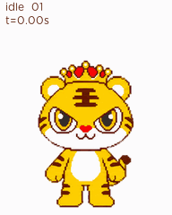

# HJXH Design 文档说明

本文件夹存放皇家小虎品牌的 AI 可执行视觉规范及配套品牌资产。

## 文件说明

- `HJXH Design.md`：核心品牌视觉规范，包含 Logo、颜色、字体、IP、动作素材及主产品摄影规则。
- `README.md`：说明规范的使用方式、资产索引、维护方式和执行边界。

## 目录与资产

| 目录 | 内容 | 使用原则 |
|---|---|---|
| `logo-png/` | 横版、竖版、黄色底板及独立头像 Logo | 直接引用，不得重绘或修改 |
| `皇家小虎品牌标准字体/` | 华康圆体与 Gotham Rounded 字体 | 按规范中的文字层级调用 |
| `皇家小虎IP规范/` | IP 说明规范及 5 个标准动作素材 | 保持角色结构、比例、颜色与气质 |
| `皇家小虎主产品摄影图/` | 披萨、烤肠、蛋挞、芝士焗、薯条、手抓饼产品图 | 保持产品真实性，不得虚构或误导 |
| `skill/hjxh-marketing-visuals/assets/pets/pixel-tiger/` | 已确认的像素小虎、完整精灵图、GIF/MP4预览与验证摘要 | 按像素衍生用途复用，保持已确认形象 |
| `skill/apple-design/` | 独立 Apple Design 技能、122个HIG页面与Liquid Glass指南 | 用于适用平台的UI/UX审核，保留原始来源与权利说明 |

## 如何使用

向 AI 提交视觉任务时，应同时提供：

1. 本文件夹中的 `HJXH Design.md`
2. 与任务匹配的 Logo、IP 动作和产品图片
3. 输出尺寸、渠道、目标受众和具体文案
4. 是否允许生成新场景、裁切产品图或创建非标准 IP 动作

### 任务选材建议

- 品牌页眉、网站导航：优先使用 `logo-png/皇家小虎logo组合-主0.png`
- 封面、海报中心：优先使用 `logo-png/皇家小虎logo组合-主1.png`
- 头像或 App 图标：优先使用透明头像 `logo-png/皇家小虎logo组合-0316-RGB_画板 1 副本 26.png`
- 推荐、品质背书：使用 `皇家小虎IP规范/动作 (2).png`
- 欢迎、庆祝：使用 `皇家小虎IP规范/动作 (1).png`
- 问候、服务引导：使用 `皇家小虎IP规范/动作 (4).png`
- 活力、行动号召：使用 `皇家小虎IP规范/动作 (5).png`
- 产品宣传：使用 `皇家小虎主产品摄影图/` 中对应的真实产品图

动作语义为便于 AI 选材建立的别名，并非原始素材官方命名。

推荐提示词：

```text
请严格遵守 HJXH Design.md，为皇家小虎制作一张 [输出类型]。

输出尺寸：[宽 × 高]
使用渠道：[渠道]
主要信息：[文案]
必须使用的 Logo：[Logo 文件路径]
必须使用的 IP 动作：[IP 动作文件路径，可选]
必须使用的产品图：[产品图文件路径，可选]
允许的处理：[裁切 / 抠图 / 背景延展 / 新场景生成]

开始前列出将遵守的 MUST 和 MUST NOT 规则。
输出前按规范检查 Logo、IP 一致性和产品真实性。
```

## 已确认规则

以下内容由当前品牌资产直接确认：

- 品牌名称、口号、标准色值和标准字体
- 横版、竖版、黄色底板及独立头像 Logo 资产
- 皇家小虎 IP 的标准视角、结构、比例、颜色、材质与角色气质
- 5 个现有 IP 动作素材
- 披萨、烤肠、蛋挞、芝士焗、薯条和手抓饼为当前主产品摄影素材

## 待确认默认规则

以下内容为便于 AI 执行提供的保守默认值，正式对外使用前 SHOULD 由品牌负责人审核：

- Logo 最小净空和最小显示尺寸
- 品牌颜色使用比例
- 字号、行高及文字层级比例
- 不同输出场景的 Logo 选择规则
- IP 动作素材的语义名称与适用场景
- 网页、海报、社交媒体及演示文稿的基础构图规则

## 资产使用注意事项

- AI MUST 直接引用现有 Logo 文件，不得重新生成或重绘。
- 新 IP 动作或新视角 MUST 以 `皇家小虎IP规范/皇家小虎IP介绍.png` 为依据，并标记为非标准动作等待审核。
- 产品宣传 MUST 优先使用真实产品图；不得虚构配料、改变产品结构或夸大份量。
- 允许裁切、缩放、抠图和背景延展，但必须保持产品与角色真实性。
- 字体文件可能受商业授权限制。对外发送、网页嵌入或提供给第三方前，必须确认授权范围。

## 维护规则

更新品牌资产时：

1. 保留旧文件，除非品牌负责人明确确认废弃。
2. 新增资产使用可识别文件名，并在无法重命名时补充语义别名。
3. 同步更新 `HJXH Design.md` 的资产目录、规则、检查清单和 Machine-Readable Tokens。
4. 标记新增规则属于“已确认规则”还是“待确认默认规则”。
5. 修改标准色、Logo、字体、IP 结构或产品事实前，必须经过品牌负责人确认。

## 建议后续补充

- Logo 矢量文件、官方安全区域、最小尺寸和错误使用示例
- IP 动作素材的官方名称、表情规范和禁用动作示例
- 主产品标准角度、抠图版、场景版和包装图
- 经品牌负责人确认的网页、海报和社交媒体模板

## Codex Skill

本仓库包含可安装的皇家小虎营销视觉 Skill：

```text
skill/hjxh-marketing-visuals
```

适用场景包括营销图片制作、制作方案输出、已有图片审核，以及经过确认后的图片修改。

本地安装时，将 `skill/hjxh-marketing-visuals/` 复制到 Codex 的个人 Skill 目录：

```text
C:\Users\<用户名>\.codex\skills\hjxh-marketing-visuals
```

调用示例：

```text
使用 $hjxh-marketing-visuals 为皇家小虎制作一张披萨朋友圈宣传图。
```

皇家小虎 Skill 的指令、流程与脚本使用仓库根目录的 `LICENSE`；品牌 Logo、IP、宠物、产品图片与字体使用 `ASSET-LICENSE.md`。导入的 Apple Design 快照不纳入本仓库的 MIT 授权，来源与权利说明见其原始 [README](skill/apple-design/README.md#origin-and-license)。

## 像素小虎宠物

2026-10-20 确认的像素小虎版本已收录，保留补齐后的下眼眶。包含九组动作、十六个视线方向和透明 v2 精灵图；技术预检、质量检查及独立方向盲评均通过。



- [定稿站姿](skill/hjxh-marketing-visuals/assets/pets/pixel-tiger/canonical.png)
- [完整精灵图](skill/hjxh-marketing-visuals/assets/pets/pixel-tiger/spritesheet.png)
- [动画视频](skill/hjxh-marketing-visuals/assets/pets/pixel-tiger/all-states.mp4)
- [视线预览](skill/hjxh-marketing-visuals/assets/pets/pixel-tiger/look-loop.gif)
- [使用边界与验证说明](skill/hjxh-marketing-visuals/references/pixel-pet.md)

这是用户确认的像素衍生资产，包含细微色阶；不替代原3D标准IP，也不代表其他营销物料的严格四色规范被放宽。

## Apple Design 技能

本仓库同时保留可独立安装的 [apple-design](skill/apple-design/SKILL.md)。将 `skill/apple-design/` 复制到个人 Skill 目录下的 `apple-design/` 即可使用；其HIG快照、主题索引、刷新脚本和来源说明完整保留。本次导入未重新抓取或改写 Apple 原文。

皇家小虎界面任务按[联合使用说明](skill/hjxh-marketing-visuals/references/apple-design-integration.md)引用。Apple 规范补充可访问性、布局、导航和交互检查；皇家小虎的 Logo、颜色、字体、IP 与产品真实性仍由品牌规范管理。
